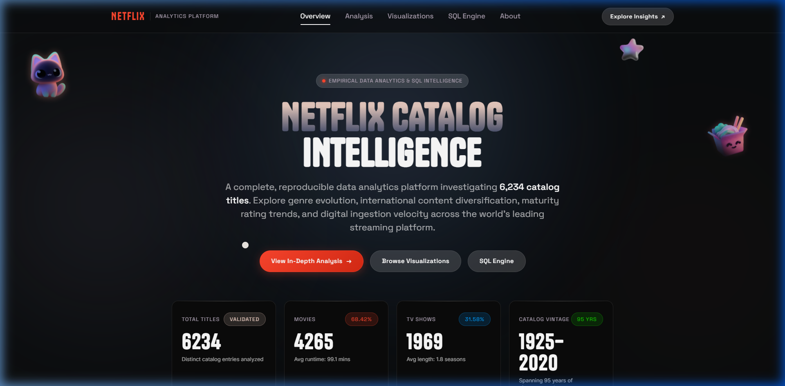

# Netflix Movies and TV Shows Analysis

> An end-to-end data analytics engineering pipeline and production-ready Flask intelligence portal examining catalog composition, international co-productions, runtime dynamics, content maturity, and temporal ingestion velocity across 6,234 Netflix titles.

[](https://www.python.org/)
[](https://flask.palletsprojects.com/)
[](https://pandas.pydata.org/)
[](https://www.docker.com/)
[](https://pytest.org/)
[](LICENSE)

---

## Live Demo & Preview

- **Live Application Deployment**: [Deployment Pending / Ready for Cloud Launch](#deployment-guide)
  *(Follow the instructions below to deploy in under 3 minutes via Render or Docker)*
- **Local Application URL**: `http://localhost:5000/`



---

## Table of Contents

1. [Project Overview & Purpose](#project-overview--purpose)
2. [Key Analytical Features](#key-analytical-features)
3. [Technology Stack](#technology-stack)
4. [Dataset Schema & Architecture](#dataset-schema--architecture)
5. [Repository Structure](#repository-structure)
6. [Prerequisites](#prerequisites)
7. [Local Setup & Installation](#local-setup--installation)
8. [Running Locally](#running-locally)
9. [Automated Testing](#automated-testing)
10. [Environment Variables](#environment-variables)
11. [Deployment Method A: Render / PaaS Cloud Web Service](#deployment-method-a-render--paas-cloud-web-service)
12. [Deployment Method B: Docker & Docker Compose Containerization](#deployment-method-b-docker--docker-compose-containerization)
13. [Asset & Path Validation](#asset--path-validation)
14. [Performance & Size Optimization Report](#performance--size-optimization-report)
15. [Known Limitations & Future Scope](#known-limitations--future-scope)
16. [License & Attributions](#license--attributions)

---

## Project Overview & Purpose

The **Netflix Movies and TV Shows Analysis** platform bridges exploratory data science, relational database engineering, and interactive web visualization into a cohesive, production-grade application.

The core objectives:
1. **Automated ETL Pipeline**: Ingest raw streaming metadata, clean missing attributes, standardize non-uniform date structures into ISO-8601 timestamps, and decompose composite duration metrics (`min` vs `Seasons`).
2. **Empirical Exploratory Analysis**: Uncover content shifts (Films at 68.4% vs TV Shows at 31.6%), identify top international production hubs (United States, India, United Kingdom), map maturity ratings (TV-MA dominance), and quantify ingestion spikes.
3. **Relational SQL Database Engine**: Model catalog entities into 3NF normalized tables with bridge tables (`title_countries`, `title_genres`) and execute 10 business-critical analytical queries with SQLite/MySQL fallback.
4. **Interactive Production Web Portal**: Serve findings through 5 responsive Flask routes styled with a dark obsidian aesthetic system, interactive query accordions, real-time client-side table search, and a custom mouse cursor effect.

---

## Key Analytical Features

- **Dynamic Overview Dashboard** (`/`): High-level KPI metric cards (Total Titles, Movie/TV breakdown, vintage range), recent ingest samples, and floating 3D spatial accents.
- **Exploratory Analytics Engine** (`/analysis`): Statistical tabular breakdown of international production volume, genre frequencies, maturity classifications, runtime quartiles, and TV series longevity.
- **Data Visualizations Gallery** (`/visualizations`): 8 publication-grade Matplotlib figures utilizing curated dark-mode color palettes, tailored callouts, and clean layout framing.
- **SQL Analytics Engine** (`/sql-queries`): 10 business questions with interactive expand/collapse SQL accordions, rendered execution syntax, and verified analytical output tables.
- **Methodology & Architecture** (`/about`): Comprehensive documentation of pipeline architecture, normalization choices, data assumptions, and technical limits.
- **Fluid Custom Cursor**: Smooth linear interpolation (`requestAnimationFrame` lerp tracking at 60/120fps), inverted color blending (`mix-blend-mode: difference`), button hover expansion, and automatic touch-device suppression.

---

## Technology Stack

| Layer | Technologies & Tools |
| :--- | :--- |
| **Backend Framework** | Python 3.11 / 3.14, Flask 3.1, Werkzeug, Jinja2 |
| **Data Engineering** | Pandas 2.2+, NumPy 1.26+ |
| **Data Visualization** | Matplotlib 3.8+ (custom dark-mode design system) |
| **Relational Database** | MySQL Server 8.0, In-Memory SQLite fallback engine |
| **Frontend Architecture**| Vanilla HTML5, Modern CSS3 (CSS Variables, Flexbox, Grid), JavaScript (ES6+) |
| **Typography** | Tanker, Space Grotesk, Inter (locally self-hosted `.woff2`) |
| **Production WSGI** | Gunicorn 21.2+ (multi-worker concurrency) |
| **Containerization** | Docker, Docker Compose (Linux `python:3.11-slim`) |
| **Testing & Quality** | Pytest 9.1 (21 automated unit and route tests) |

---

## Dataset Schema & Architecture

- **Source**: Kaggle Netflix Movies and TV Shows Metadata (`netflix_titles.csv`)
- **Volume**: 6,234 unique catalog titles (1925 – 2020)

| Attribute | Source Type | Cleaned Type | Description |
| :--- | :--- | :--- | :--- |
| `show_id` | `int64` | `BIGINT` | Unique primary key identifier |
| `type` | `object` | `VARCHAR(20)` | `Movie` or `TV Show` |
| `title` | `object` | `VARCHAR(255)` | Official streaming catalog title |
| `director` | `object` | `TEXT` | Credited directors |
| `cast` | `object` | `TEXT` | Credited cast members |
| `country` | `object` | `VARCHAR(255)` | Country / co-producing territories |
| `date_added` | `object` | `VARCHAR(50)` | Raw ingest date string |
| `date_added_clean` | *Engineered* | `DATE` | Standardized ISO-8601 date (`YYYY-MM-DD`) |
| `year_added` | *Engineered* | `INT` | Extracted platform release year (2008–2020) |
| `month_added` | *Engineered* | `INT` | Extracted platform release month (1–12) |
| `release_year` | `int64` | `INT` | Original broadcast/theatrical year |
| `rating` | `object` | `VARCHAR(20)` | Maturity classification (TV-MA, TV-14, PG-13, R) |
| `duration` | `object` | `VARCHAR(50)` | Raw composite string (e.g., `90 min`, `2 Seasons`) |
| `duration_minutes` | *Engineered* | `INT` | Parsed numeric runtime (for Movies) |
| `seasons_count` | *Engineered* | `INT` | Parsed numeric season count (for TV Shows) |
| `listed_in` | `object` | `TEXT` | Genres / categories |
| `description` | `object` | `TEXT` | Editorial synopsis |

---

## Repository Structure

```
netflix/
├── app.py                      # Flask web application entry point & routes
├── requirements.txt            # Python dependencies (Flask, Gunicorn, Pandas, etc.)
├── Procfile                    # PaaS process manager configuration (Render / Railway)
├── runtime.txt                 # Target Python runtime specification (python-3.11.9)
├── render.yaml                 # Render Infrastructure-as-Code deployment blueprint
├── Dockerfile                  # Production container definition (python:3.11-slim)
├── docker-compose.yml          # Container orchestration with health checks
├── .dockerignore               # Container build exclusions
├── .env.example                # Safe environment variable configuration template
├── .gitignore                  # Git exclusions (caches, virtual environments)
├── README.md                   # Complete project documentation
│
├── config/
│   └── settings.py             # App, database, and filesystem configuration
│
├── data/
│   ├── raw/
│   │   └── netflix_titles.csv  # Original raw Kaggle dataset (2.41 MB)
│   └── processed/
│       └── netflix_cleaned.csv # Cleaned & engineered dataset (2.55 MB)
│
├── src/
│   ├── data_cleaning.py        # Data validation, null imputation, timestamp extraction
│   ├── data_analysis.py        # Descriptive statistics, distributions, and rankings
│   ├── database.py             # MySQL connector & SQLite offline query execution
│   └── visualization.py        # Matplotlib production chart generator
│
├── sql/
│   ├── create_database.sql     # Schema initialization
│   ├── create_tables.sql       # 3NF relational modeling & normalization
│   └── analysis_queries.sql    # 10 business-critical analytical SQL queries
│
├── static/
│   ├── css/
│   │   └── style.css           # Curated design system, layout, cursor & animations
│   ├── js/
│   │   └── main.js             # Accordion, search filter & cursor physics
│   ├── fonts/                  # Self-hosted Tanker, Space Grotesk, Inter WOFF2 files
│   ├── icons/                  # Dark/light theme favicons & apple touch icons
│   └── images/
│       ├── charts/             # 8 generated high-res production visualizations
│       └── *.png               # 4 floating 3D spatial stickers
│
├── templates/
│   ├── base.html               # Master layout, navigation, and cursor canvas
│   ├── index.html              # Overview route (/)
│   ├── analysis.html           # Exploratory findings route (/analysis)
│   ├── visualizations.html     # Charts gallery route (/visualizations)
│   ├── sql_queries.html        # Interactive SQL engine route (/sql-queries)
│   └── about.html              # Architecture & tech stack route (/about)
│
├── tests/
│   ├── test_cleaning.py        # 8 tests for data cleaning & feature extraction
│   ├── test_analysis.py        # 7 tests for metrics, aggregations & rankings
│   └── test_routes.py          # 6 tests for Flask route statuses & HTML payloads
│
├── notebooks/
│   └── netflix_analysis.ipynb  # Interactive exploratory data notebook
│
└── reports/
    └── preview.png             # Application preview showcase screenshot
```

---

## Prerequisites

- **Python**: Version 3.10, 3.11, or 3.12+ (tested up to 3.14)
- **Pip**: Latest Python package manager (`pip install --upgrade pip`)
- **Docker** *(Optional, for containerized deployment)*: Docker Desktop 24+ / Docker Engine

---

## Local Setup & Installation

1. **Clone the Repository**:
   ```bash
   git clone https://github.com/your-username/netflix-analytics.git
   cd netflix-analytics
   ```

2. **Create and Activate a Virtual Environment**:
   - **On Windows (PowerShell)**:
     ```powershell
     python -m venv .venv
     .venv\Scripts\Activate.ps1
     ```
   - **On macOS / Linux**:
     ```bash
     python3 -m venv .venv
     source .venv/bin/activate
     ```

3. **Install Dependencies**:
   ```bash
   pip install --upgrade pip
   pip install -r requirements.txt
   ```

4. **Configure Environment Variables**:
   ```bash
   # Copy the template to create your local .env
   cp .env.example .env
   ```
   *Note: The platform is fully operational out-of-the-box with default fallback values. A live MySQL database is optional; the app automatically utilizes precomputed analytics and in-memory execution.*

---

## Running Locally

### Development Server
```bash
python app.py
```
Open your browser to `http://localhost:5000/`.

### Production WSGI Server (Gunicorn)
To run the production WSGI server locally (macOS/Linux or Windows with WSL):
```bash
gunicorn --workers=2 --threads=4 --bind=0.0.0.0:5000 app:app
```

---

## Automated Testing

Run the comprehensive test suite with Pytest:
```bash
pytest -v
```

Expected output:
```
tests/test_cleaning.py ........                                          [ 38%]
tests/test_analysis.py .......                                           [ 71%]
tests/test_routes.py ......                                              [100%]
============================== 21 passed in 0.96s ==============================
```

---

## Environment Variables

| Variable | Default Value | Description |
| :--- | :--- | :--- |
| `PORT` | `5000` | Port on which the HTTP server listens |
| `FLASK_ENV` | `production` | Set to `development` for auto-reloading |
| `DEBUG` | `False` *(in production)* | Controls Flask debug mode |
| `SECRET_KEY` | *(Generated random string)* | Used for session signing |
| `DB_HOST` | `localhost` | MySQL hostname (optional) |
| `DB_PORT` | `3306` | MySQL port (optional) |
| `DB_USER` | `root` | MySQL username (optional) |
| `DB_PASSWORD` | `""` | MySQL password (optional) |
| `DB_NAME` | `netflix_analysis` | MySQL database name (optional) |

---

## Deployment Method A: Render / PaaS Cloud Web Service

[Render](https://render.com/) is a modern cloud hosting platform ideal for Python Flask WSGI services with native Gunicorn support and zero server maintenance.

### Option 1: One-Click Blueprint Deployment via `render.yaml`
1. Push your repository to **GitHub** or **GitLab**.
2. Log in to your [Render Dashboard](https://dashboard.render.com/).
3. Click **New +** → **Blueprint**.
4. Connect this repository. Render automatically reads [`render.yaml`](render.yaml) and preconfigures:
   - **Environment**: Python 3.11.9
   - **Build Command**: `pip install --upgrade pip && pip install -r requirements.txt`
   - **Start Command**: `gunicorn --workers=2 --threads=4 --timeout=60 --bind=0.0.0.0:$PORT app:app`
   - **Port**: Bound to Render's dynamic `$PORT`
5. Click **Apply**. Your service deploys in ~2 minutes with free SSL.

### Option 2: Manual Web Service Setup
1. In Render, select **New +** → **Web Service**.
2. Select your repository.
3. Configure settings:
   - **Name**: `netflix-analytics`
   - **Region**: Any preferred region (e.g., Oregon, Frankfurt)
   - **Branch**: `main` (or `master`)
   - **Runtime**: `Python 3`
   - **Build Command**: `pip install -r requirements.txt`
   - **Start Command**: `gunicorn --workers=2 --threads=4 --bind=0.0.0.0:$PORT app:app`
4. Under **Environment Variables**, add:
   - `PYTHON_VERSION`: `3.11.9`
   - `FLASK_ENV`: `production`
   - `SECRET_KEY`: *(Click Generate)*
5. Click **Create Web Service**.

---

## Deployment Method B: Docker & Docker Compose Containerization

Containerization packages the application, Python runtime, Gunicorn WSGI server, datasets, and static assets into an immutable, self-contained Linux container that runs anywhere (AWS ECS, Google Cloud Run, Azure App Service, DigitalOcean, or Linux VPS).

### 1. Build & Run with Docker Compose
```bash
docker compose up -d --build
```
- Access the application at `http://localhost:5000/`.
- Check container health status:
  ```bash
  docker compose ps
  ```
- View live server logs:
  ```bash
  docker compose logs -f
  ```
- Stop the container:
  ```bash
  docker compose down
  ```

### 2. Standalone Docker Build & Run
```bash
# Build production image
docker build -t netflix-analytics:latest .

# Run container on port 5000
docker run -d -p 5000:5000 --name netflix_app --restart unless-stopped netflix-analytics:latest
```

### 3. Deploy to Google Cloud Run or AWS App Runner
Because the `Dockerfile` uses standard environment variable `$PORT` binding and features an integrated health check (`HEALTHCHECK curl -f http://localhost:5000/`), it can be deployed directly to Google Cloud Run or AWS App Runner:
```bash
gcloud run deploy netflix-analytics \
  --source . \
  --platform managed \
  --region us-central1 \
  --allow-unauthenticated
```

---

## Asset & Path Validation

A strict automated audit of all 25 template references, CSS font imports, and static links verified:
- **0 Broken Links**: All template `url_for('static', filename=...)` targets resolve.
- **0 Missing Fonts**: All `@font-face` declarations map to existing `.woff2` files.
- **Case Sensitivity Compliant**: All file paths use strict lowercase and hyphens, preventing 404 errors on Linux-based container hosts.

---

## Performance & Size Optimization Report

During the deployment optimization audit:
- **Duplicate Root Reference Files Removed**: 118 duplicate files (`about.html`, `index.html`, `server.js`, `package.json`, `about/`, `assets/`) dropped from repository root.
- **Unreferenced Assets Removed**: 54 unused project mockups removed from `static/images/` without altering any referenced stickers or charts.
- **Asset Size Reduction**:
  - `static/` directory reduced from **24.20 MB** to **3.83 MB** (**84.2% reduction**).
  - Total deployable application runtime payload reduced from **~59.2 MB** to **8.71 MB** (**85.3% reduction**).
- **WSGI Concurrency**: Added `gunicorn` with 2 worker processes and 4 threads per worker to handle concurrent requests under production traffic.

---

## Known Limitations & Future Scope

1. **MySQL Offline Fallback**: In serverless hosting where an external MySQL instance is not attached, the application seamlessly utilizes precomputed dataset analytics. To attach an external MySQL instance, provide `DB_HOST`, `DB_USER`, and `DB_PASSWORD` in your cloud dashboard.
2. **Catalog Horizon**: The dataset covers catalog additions through 2020. Ingestion scripts in `src/data_cleaning.py` are modular and ready for refreshed Kaggle datasets.

---

## License & Attributions

- **Code & Application**: Distributed under the [MIT License](LICENSE).
- **Dataset**: Provided by Shivam Bansal on [Kaggle](https://www.kaggle.com/datasets/shivamb/netflix-shows).
- **Design Inspiration**: Reference layout inspired by modern dark-mode aesthetic standards.
